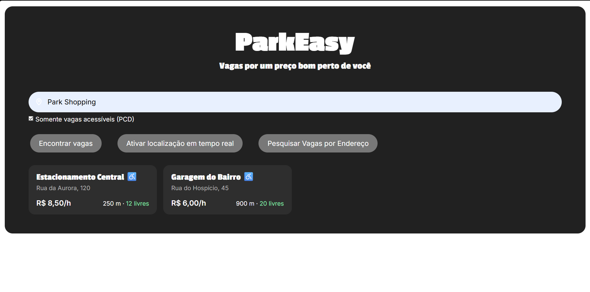
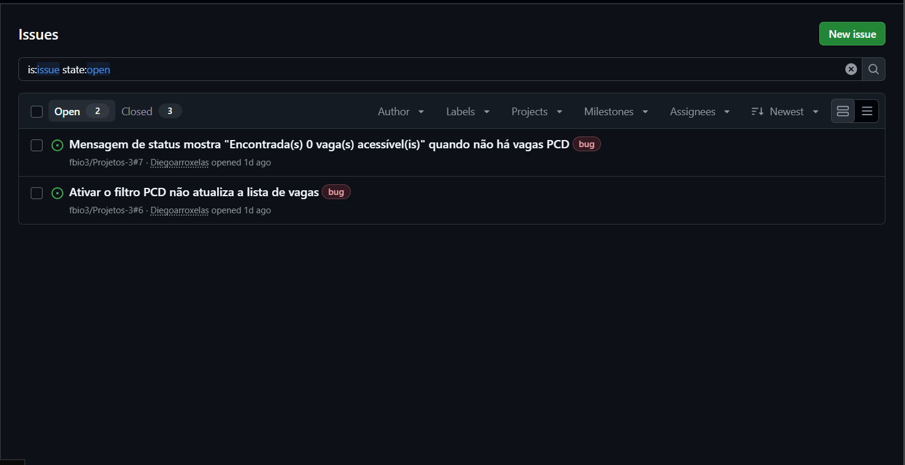

# Projetos 3: Park Easy
ParkEasy é um site que conecta usuários procurando vagas para estacionar veículos à vagas disponíveis próximas cadastradas por um certo valor.

Tecnologias usadas no desenvolvimento: Java, Spring Boot, React, PostgreeSQL, Node.js, Spring Web, JavaScript, CSS3, HMTL5.

| Membro | E-mail |
| :--- | :--- |
| Bernardo Pedrosa Alves Abreu | bpaa@cesar.school |
| Diego José Arroxelas Galvão Albuquerque Maranhão | Djagam@cesar.school |
| Fabio Henrique Dantas Layme Lopes de Albuquerque | fhdlla@cesar.school |
| Francisco de Amorim Marquese | fam3@cesar.school |
| Guilherme Henrique Leite Nóbrega | ghln@cesar.school |
| Pedro Gabriel Paes da Justa Silva | pgpjs@cesar.school |
| Lucas Rocha Calado | lrc3@cesar.school |
| Maria Clara Miranda Ferraz | Mcmf2@cesar.school |

# Entrega 1

* 🔗 **[Clique aqui para acessar as Histórias de Usuário e Cenários BDD](./BDD.md)**  
* 🔗 Figma:  **https://www.figma.com/design/0zYZ7hXAx9qSK5j6xzSoV3/Trabalho-POO?node-id=0-1&t=hdKBW8uIVpm7rzWn-1**  
* 🔗 Screencast: **https://youtu.be/bzjy19k4I-w?is=Q7nv4KDybstOR952**
---

# Entrega 2

## 📜 Histórias Implementadas

> 📌 **História de Usuário 02 — Visualizar vagas próximas no mapa**  
> **Como** motorista,  
> **Quero** visualizar no mapa as vagas disponíveis próximas à minha localização atual,  
> **Para** encontrar rapidamente onde estacionar.  

> 📌 **História de Usuário 03 — Pesquisar vagas por endereço**  
> **Como** motorista,  
> **Quero** pesquisar vagas próximas a um endereço específico,  
> **Para** planejar onde estacionar antes de chegar ao meu destino.

---

## 🎥 Screencasts (YouTube)

* 🔗 **Uso do Sistema (Spring Boot Rodando):** [Assistir Vídeo do Uso do Sistema](https://youtu.be/ods2P-Mu_C8)
* 🔗 **Explicação do código das histórias implementadas:** [Assistir Vídeo da Explicação do Código](https://youtu.be/TEi_j4Bat6k)

---

<H2>🐛 Issue / Bug Tracker (GitHub)</H2>

*(Utilização do GitHub Issues/Projects em todas as semanas da entrega)*

---

# Entrega 03

## 📜 Histórias Implementadas

> 📌 **História de Usuário 01 — Filtrar vagas acessíveis (PCD)**  
> **Como** motorista com deficiência,  
> **Quero** filtrar vagas acessíveis (PCD),  
> **Para** garantir que o local atenda minhas necessidades.

> 📌 **História de Usuário 05 — Ver valor estimado antes de ir**  
> **Como** motorista,  
> **Quero** ver o valor estimado antes de ir para a vaga,  
> **Para** saber quanto vou pagar.

---

## 🎥 Screencasts (YouTube)

* 🔗 **Sistema funcionando (novas histórias):** [Assistir Vídeo do Uso do Sistema](https://youtu.be/ztiag7sU68c)
* 🔗 **Explicação do código das histórias implementadas:** [Assistir Vídeo da Explicação do Código](https://youtu.be/5fgyGqbKtIc)

---

<H2>🖥️ Print da Tela<H2>

---

<H2>🐛 Issue / Bug Tracker (GitHub)</H2>

*(Utilização do GitHub Issues/Projects atualizado, com commits frequentes ao longo da entrega)*

* bugs novos encontrados no sistema

---
